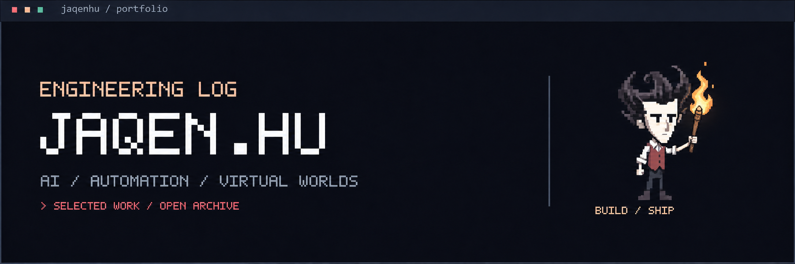
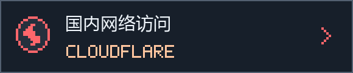
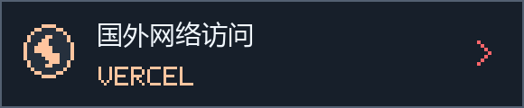

<p align="center">
  
</p>

# Jaqen Hu / Portfolio

**AI Engineering · Workflow Automation · Digital Twin & VR**

个人作品集，记录我在 AI 应用、自动化系统与虚拟交互方面的工程实践。

关注模型、数据与业务系统的连接：从知识检索、工具调用到多步骤任务执行，也包括数字孪生场景与沉浸式培训系统的设计和交付。

##  在线访问

<p>
  <a href="https://jaqenhu-portfolio.pages.dev/"></a>
  <a href="https://jaqenhu-portfolio.vercel.app/"></a>
</p>

两个地址提供同一作品集，可根据网络环境选择。

##  项目与实践

###  AI Agent 与工作流自动化

整合大模型与业务工具，构建面向企业场景的自动化工作流。

`FastGPT` · `n8n` · `FastAPI` · `Docker`

###  RAG 知识库

结合语义检索与重排序，提供可追溯来源的企业文档问答。

`RAGFlow` · `Embedding` · `Reranker`

###  数字孪生与 VR 培训

结合 BIM 与实时三维交互，构建设备操作、巡检和应急演练场景。

`Unreal Engine 5` · `BIM` · `OpenXR` · `C++`

##  关于这个网站

网站集中展示个人背景、项目方案、技术能力与协作反馈。项目卡片支持展开查看实现方式和交付结果。

界面采用暗色视觉，结合粒子背景、打字效果、鼠标轨迹与滚动动效，适配桌面和移动设备。

**前端：** React 19 · Vite 6<br>
**交互：** GSAP · Canvas · CSS<br>
**部署：** Cloudflare Pages · Vercel

##  本地运行

<details>
<summary>环境、启动命令与目录结构</summary>

安装 Node.js，下载仓库并进入项目目录：

```bash
npm ci
npm run dev
```

打开终端输出的本地地址即可查看。

生成生产版本：

```bash
npm run build
```

构建结果输出至 `dist/`。

```text
src/
├── data.js       个人资料、项目与技能数据
├── components/   页面组件
└── index.css     全局样式与动效

public/           图片与本地字体
```

</details>

##  联系

项目合作、技术交流与开源协作：

**Email → [jaqenhu@foxmail.com](mailto:jaqenhu@foxmail.com)**<br>
**GitHub → [@jaqenhu](https://github.com/jaqenhu)**

---

<p align="center"><strong>Build. Evaluate. Iterate.</strong></p>
